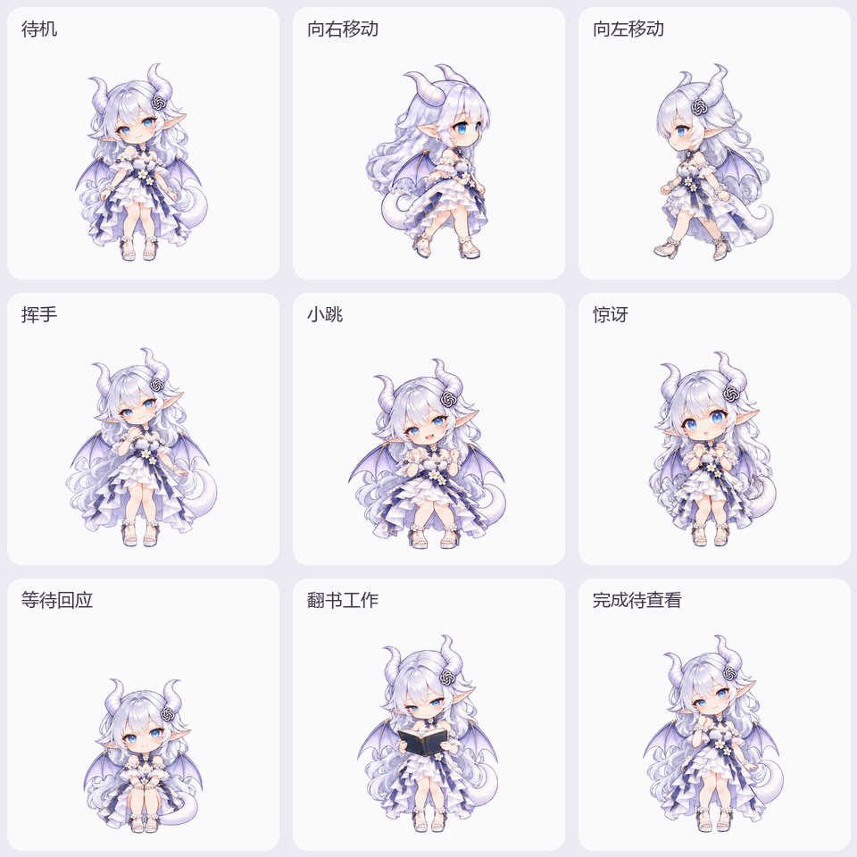

# Astra · 白龙娘桌宠

为 Codex 桌面版制作的透明二维动画桌宠。银白长发、蓝瞳、白色龙角与尾巴，搭配淡紫翅膀和花饰连衣裙。

本仓库提供清晰度优化版：9 种动作、16 个视线方向，以及额外的困倦动画。它是自定义宠物素材包，运行时依赖 Codex 桌面应用；不是可独立运行的桌宠程序。



## 安装到 Windows Codex

1. 点击本页 **Code → Download ZIP**，完整解压。
2. 在解压目录中打开 PowerShell，运行：

```powershell
.\install-update.ps1
```

3. 打开 Codex **设置 → Pets / 宠物 → Refresh / 刷新**，选择 **Astra · 白龙娘**。
4. 输入 `/pet` 显示桌宠。如果仍显示旧缓存，先切换其他宠物，再选回 Astra。

脚本使用 `CODEX_HOME`；未设置时使用当前用户的 `.codex`，将素材安装到 `pets/astra-white-dragon`。更新同名宠物前会备份旧配置和旧图，保存在 `backup-before-clarity-v2`。脚本校验图片的 SHA-256，不修改宠物选择，也不修改其他宠物。

也可手动将 `final/pet.json` 和 `final/spritesheet-clarity-v2.png` 复制到 `.codex/pets/astra-white-dragon/`。更新前请保存已有文件。

## 查看动画

- 下载后用浏览器打开 [preview.html](preview.html)，可切换动作、背景、播放速度和逐帧检查。
- [全部动作视频](previews/astra-clarity.mp4)
- [透明待机动画](previews/idle.webp)
- [16 个视线方向](previews/look-directions.webp)
- [原生帧优化对比](previews/native-comparison.png)

预览默认使用从原始大图导出的高精度素材，可切换为“桌宠实际帧”。高精度预览图不能直接用作 Codex 安装图。

## 动作及触发

| 动作 | Codex 状态或操作 |
| --- | --- |
| 呼吸、眨眼 | 空闲待机 |
| 抱书翻阅 | 聊天正在执行任务 |
| 坐下等待 | 需要用户输入、审批或选择 |
| 托腮 | 任务完成，结果待查看 |
| 惊讶、担忧 | 任务失败或出错 |
| 挥手 | 首次唤醒宠物的欢迎提示 |
| 小跳 | 鼠标移入宠物区域 |
| 向左／向右移动 | 向对应方向拖动宠物 |
| 调整视线 | 应用提供输入光标或电脑操作指针位置时 |
| 困倦 | 额外素材，可在预览中播放，没有原生自动触发状态 |

上述映射按制作时本机 Codex 26.1007.2314.0 检查，后续应用版本可能调整。多任务状态由 Codex 决定，不由素材配置控制。完全退出 Codex 后，内置桌宠也会关闭。

## 素材规格

| 文件 | 用途与尺寸 |
| --- | --- |
| `final/spritesheet-clarity-v2.png` | 原生 v2 图集；1536×2288；8 列×11 行；每格 192×208 |
| `final/spritesheet-preview-2x.png` | 放大预览；3072×4576；每格 384×416 |
| `previews/*.webp` | 无损透明动画预览 |
| `extras/sleepy-strip*.png` | 额外困倦动作 |

原生图集包含 73 个有效帧、15 个空白透明格。清晰度优化沿用同一套角色原始图像，减少反复缩放和过强边缘清理，保持原有表情与动作。所有角色图像最初使用内置 imagegen 生成。

已检查图集尺寸、透明通道、帧数、角色边界、文件校验值与动画解码。当前原生每帧分辨率仍受应用限制；未宣称原生桌宠能够达到放大预览的精度。

## 恢复旧版

如果安装目录存在 `backup-before-clarity-v2`，将其中的旧 `pet.json` 和对应图片复制回 `astra-white-dragon`，然后在 Pets 设置中刷新。项目没有启用开机自启动或额外后台服务。

本项目为用户自定义角色素材，并非 OpenAI 官方角色或官方发行的桌宠。
